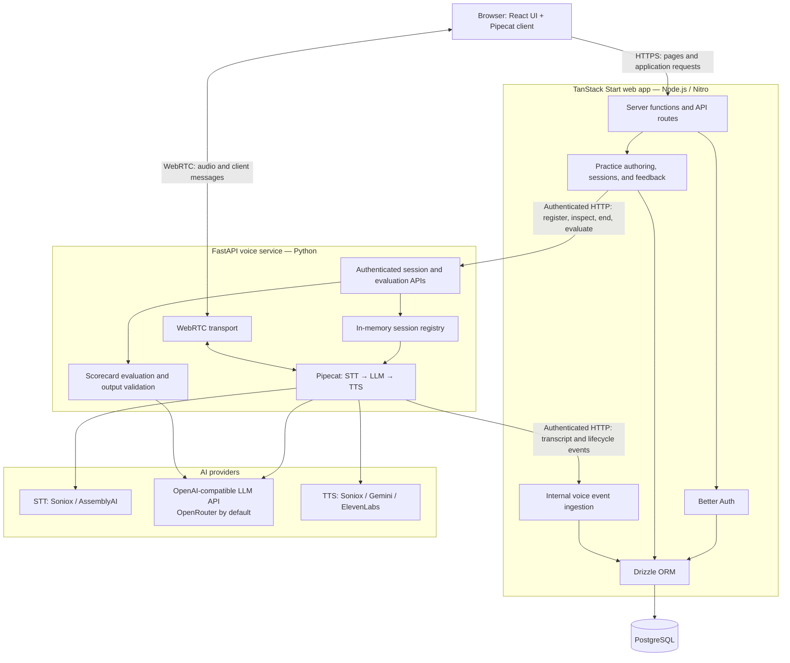
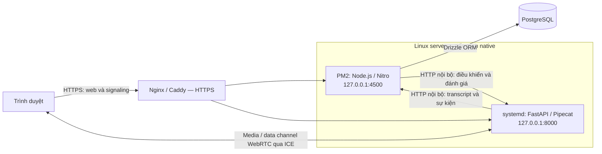

# Architecture Document

## System Overview

SalesCoach AI gồm ứng dụng web TanStack Start (React/TypeScript) và dịch vụ giọng nói FastAPI (Python): ứng dụng web quản lý xác thực bằng Better Auth, bài luyện tập, phiên luyện và kết quả trong PostgreSQL thông qua Drizzle ORM. Trình duyệt kết nối trực tiếp với dịch vụ giọng nói qua WebRTC; Pipecat điều phối STT, LLM và TTS để AI đóng vai khách hàng bất động sản, trong khi máy chủ web đăng ký và điều khiển phiên qua API nội bộ có xác thực. Dịch vụ giọng nói gửi transcript và sự kiện vòng đời về máy chủ web để lưu trữ, đồng thời cung cấp API đánh giá hội thoại theo scorecard bằng LLM; trạng thái runtime của phiên giọng nói được giữ trong bộ nhớ tiến trình Python.

## Architecture Diagram



## Components

### 1. Frontend (TanStack Start / React)
- **Purpose:** Cung cấp giao diện luyện kỹ năng sale bất động sản bằng React/TypeScript, đồng thời chạy server functions và API routes của TanStack Start trên Node.js/Nitro để xử lý xác thực, dữ liệu bài luyện và điều phối phiên giọng nói.
- **Key Features:**
  - Đăng ký, đăng nhập, xác minh email và đặt lại mật khẩu qua Better Auth.
  - Duyệt danh mục, tạo bài luyện tập và xem đề xuất bài luyện.
  - Hội thoại trực tiếp với khách hàng AI qua Pipecat browser SDK và WebRTC, chọn thiết bị âm thanh, điều khiển micro và hiển thị transcript.
  - Bắt đầu, kết thúc và kết nối lại phiên luyện; xem phản hồi theo scorecard và thử đánh giá lại khi có lỗi.
  - Máy chủ web đăng ký và điều khiển phiên trên FastAPI qua API nội bộ có xác thực, tiếp nhận sự kiện giọng nói và lưu dữ liệu bằng Drizzle ORM vào PostgreSQL; trình duyệt truyền âm thanh trực tiếp tới dịch vụ giọng nói.
  - Trang quản trị `/admin/dashboard` cho đội vận hành, chỉ dành cho tài khoản có `roles` chứa `admin`: tình trạng dịch vụ, người dùng hoạt động, cuộc gọi theo ngày, kết quả phiên, bài luyện dùng nhiều nhất, chi phí dịch vụ AI và phiên gần đây kèm transcript. Chi phí được ước tính từ lượng dùng mà dịch vụ giọng nói báo cáo (giây âm thanh STT, ký tự TTS, token LLM của cuộc gọi trong sự kiện `usage.recorded`, token LLM chấm điểm qua header `X-Service-Usage`), lưu trong bảng `service_usage` và nhân với bảng giá trong `frontend/src/lib/admin/service-prices.ts` khi đọc; mô hình chưa có giá được liệt kê riêng và không tính vào tổng. Ngày được gom theo múi giờ `Asia/Ho_Chi_Minh`. Khi làm mới thất bại, dữ liệu đã tải vẫn hiển thị nhưng được đánh dấu là dữ liệu cũ; trạng thái tổng thể không xác nhận dịch vụ đang hoạt động. Trước khi đọc số liệu hoặc phiên, máy chủ dùng luồng đối soát lease hiện có để cập nhật phiên hết hạn; kết nối còn hoạt động được xác nhận với backend trước khi gia hạn, không bỏ phiên chỉ vì lease lưu trong DB đã cũ. Các lần đọc số liệu và phiên đồng thời dùng chung một lượt đối soát.
  - Máy chủ web kiểm tra PostgreSQL và dịch vụ giọng nói mỗi 30 giây và gửi email cho các admin khi một dịch vụ ngừng hoặc hoạt động trở lại (`SERVICE_ALERT_EMAILS`, mặc định bật khi `NODE_ENV=production`). Truy vấn người nhận có deadline 3 giây sau khi lấy connection (pool có timeout 10 giây); nếu lỗi, connection bị hủy và danh sách người nhận thành công gần nhất được giữ lại để bộ kiểm tra tiếp tục. Email chưa gửi được (chưa có admin đã xác minh email, hoặc SMTP từ chối) được gửi lại ở các lần kiểm tra sau cho đến khi tới được ít nhất một admin. Bộ kiểm tra chạy trong tiến trình web, bắt đầu từ request đầu tiên sau khi khởi động, nên không báo được sự cố của chính ứng dụng web.
- **State Management:**
  - TanStack Router quản lý định tuyến theo tệp và ngữ cảnh người dùng; TanStack Query quản lý cache dữ liệu máy chủ (danh mục, đề xuất, phiên luyện và phản hồi), tích hợp SSR và cập nhật/invalidate cache sau thao tác.
  - React hooks quản lý trạng thái giao diện, transcript đang hiển thị, trạng thái kết nối và thiết bị âm thanh; `usePracticeSession` giữ Pipecat client và các tài nguyên kết nối trong refs, đồng thời xử lý heartbeat và cleanup.
  - PostgreSQL lưu dữ liệu phiên, transcript và kết quả đánh giá lâu dài; trạng thái cục bộ trong trình duyệt chỉ phục vụ tương tác thời gian thực.

### 2. Backend (FastAPI)
- **Purpose:** Chạy dịch vụ giọng nói Python tại `src.main:app`, quản lý runtime và phiên luyện trong `src/salescoach_voice/`, điều phối hội thoại WebRTC bằng Pipecat và tạo đánh giá theo scorecard bằng LLM. Backend gửi transcript và sự kiện vòng đời về máy chủ web để lưu vào PostgreSQL; session registry và nonce đã sử dụng được giữ trong bộ nhớ tiến trình Python.
- **API Design:** HTTP/JSON với validation bằng Pydantic; âm thanh và thông điệp thời gian thực truyền qua WebRTC.
  - `GET /health`, `/health/live`, `/health/ready`: kiểm tra tiến trình và trạng thái sẵn sàng nhận phiên mới của runtime.
  - `POST /internal/sessions`, `GET /internal/sessions/{session_id}`, `POST /internal/sessions/{session_id}/end`: đăng ký, đọc trạng thái và kết thúc phiên.
  - `POST /internal/evaluations`: đánh giá transcript; trả HTTP 502 kèm mã lỗi và chẩn đoán khi đánh giá thất bại.
  - `GET /internal/status`: trạng thái sẵn sàng, số phiên đang giữ chỗ và giới hạn `MAX_CONCURRENT_SESSIONS`, dùng cho trang quản trị.
  - `POST /api/offer`, `PATCH /api/offer`: thương lượng kết nối WebRTC và bổ sung ICE candidates.
- **Authentication:**
  - API `/internal/*` yêu cầu Bearer control key (`VOICE_CONTROL_API_KEY`) dùng giữa máy chủ web và dịch vụ giọng nói.
  - `/api/offer` yêu cầu JWT HS256 (`VOICE_TOKEN_SECRET`), kiểm tra audience, thời hạn và ràng buộc người dùng, phiên và connection attempt; nonce được tiêu thụ khi tạo offer để ngăn tái sử dụng token.
  - Better Auth trên máy chủ web xử lý đăng nhập người dùng. Các endpoint health hiện không yêu cầu xác thực.
- **Runtime & Deployment:** Lifespan khởi tạo và đóng tài nguyên giọng nói; session registry và watchdog quản lý giới hạn phiên, heartbeat, timeout và cleanup kết nối. Chạy một Uvicorn worker mỗi instance vì registry và nonce store không được chia sẻ giữa các tiến trình; triển khai nhiều instance cần shared state hoặc session affinity.

### 3. AI Agent
- **Agent Type:** Agent hội thoại tùy biến đóng vai khách hàng bất động sản theo kịch bản bài luyện. Luồng luyện giọng nói hiện dùng Pipecat và OpenAI SDK qua API tương thích OpenAI (mặc định OpenRouter).
- **LLM Integration:** `providers/llm.py` tạo Pipecat `OpenAILLMService` cho hội thoại; `evaluation.py` gọi trực tiếp `AsyncOpenAI.chat.completions.create` để đánh giá. Endpoint và model được cấu hình qua `VOICE_AGENT_LLM_BASE_URL`, `VOICE_AGENT_LLM_MODEL` và `VOICE_EVALUATION_LLM_MODEL`.
- **State:** System prompt và lời chào đầu tiên được máy chủ web cung cấp khi đăng ký phiên. Pipecat giữ ngữ cảnh hội thoại trong `LLMContext` và các user/assistant aggregators; session registry theo dõi trạng thái runtime, connection attempt và vòng đời worker. Transcript được gửi về máy chủ web để lưu lâu dài và làm ngữ cảnh khi kết nối lại.
- **Processing:** Pipeline gồm WebRTC input, cổng kiểm soát lượt mở đầu, STT, thu thập transcript, user context aggregator, LLM, TTS, WebRTC output và assistant context aggregator. Phát hiện lượt nói phụ thuộc profile STT; lời chào cấu hình sẵn được phát trước khi mở đầu vào cho người luyện.
- **Tools:** Luồng agent hiện chưa dùng đến tool, vì vậy không khai báo tool calling, ReAct hay truy xuất vector/RAG.
- **Practice Evaluation:** Dịch vụ đánh giá nhận transcript của phiên luyện tập của người dùng, dữ liệu bài luyện và rubric để tạo phản hồi theo scorecard bằng strict JSON Schema; kiểm tra điểm, các key tham chiếu và bằng chứng trích dẫn trước khi trả kết quả. Cho phép tối đa hai lần gọi trong deadline tổng 45 giây; lỗi sau khi hết lượt được trả về máy chủ web để người dùng có thể thử đánh giá lại.
- **Flow:**

```mermaid
graph LR
    Scenario["System prompt + lời chào"] --> Context["Ngữ cảnh hội thoại"]
    Scenario --> Opening["Phát lời chào qua TTS"]
    Opening --> Input["Mở đầu vào WebRTC"]
    Input --> STT["STT"]
    STT --> User["User context aggregator"]
    Context --> User
    User --> LLM["Pipecat OpenAILLMService"]
    LLM --> TTS["TTS"]
    TTS --> Output["WebRTC audio output"]
    Output --> Assistant["Assistant context aggregator"]
    Assistant --> Context
    STT --> Transcript["Transcript lưu qua máy chủ web"]
    Output --> Transcript
    Transcript --> Evaluation["OpenAI SDK: đánh giá theo rubric"]
    Evaluation --> Validation["Validate JSON và bằng chứng"]
    Validation --> Feedback["Phản hồi theo scorecard"]
```



### 4. Database
- **Type:** PostgreSQL, truy cập từ máy chủ web TanStack Start bằng Drizzle ORM và driver `node-postgres`. Kết nối được cấu hình qua `DATABASE_URL`; schema nguồn nằm tại `frontend/src/db/schema.ts`.
- **Tables:** 15 bảng tổng cộng: 4 bảng xác thực, 10 bảng nghiệp vụ luyện tập và 1 bảng hoạt động người dùng.
  - **Hoạt động người dùng:** `user_activity_days` lưu một dòng cho mỗi người dùng mỗi ngày có truy cập khi đã đăng nhập, phục vụ số "người dùng hoạt động" của trang quản trị. Bảng `session` không dùng được cho việc này vì Better Auth xóa dòng khi đăng xuất hoặc hết hạn.
  - **Xác thực (Better Auth):** `user`, `session`, `account`, `verification` lưu người dùng, phiên đăng nhập, tài khoản và dữ liệu xác minh. `session` là phiên xác thực, khác với phiên luyện trong `practice_sessions`.
  - **Nội dung bài luyện:** `sales_offerings` lưu sản phẩm bất động sản; `practices` lưu bài luyện; `practice_agent_configs` là bảng riêng một-một theo `practice_id`, chỉ lưu `config` và `updated_at` ngoài khóa; `competencies` và `practice_competencies` định nghĩa tiêu chí đánh giá và liên kết chúng với bài luyện. Không có active flag, tên nội bộ bài luyện, category của competency hay prompt revision theo bài luyện.
  - **Phiên luyện và kết quả:** `practice_sessions` lưu mỗi lần luyện cùng trạng thái vòng đời; `practice_session_turns` lưu transcript, không có cột audio placeholder. Số lượt và thời lượng được suy ra từ transcript và timestamp. `practice_session_evaluations` dùng `session_id` làm khóa chính và lưu điểm tổng thể duy nhất cùng phản hồi; `practice_session_competency_scores` lưu điểm/bằng chứng bất biến theo từng tiêu chí và `profile_applied_at` để đánh dấu bằng chứng đã áp dụng.
  - **Hồ sơ năng lực:** `learner_competency_profiles` lưu mastery, số bằng chứng và thời điểm luyện gần nhất, không lưu confidence hay session cuối. Confidence được suy ra: 0 bằng chứng → 0; 1 → 20; từ 2 trở lên → `min(100, (count + 1) * 20)`, giữ nguyên hành vi cũ chứ không sửa thành tuyến tính. Không có bảng ledger riêng; claim `profile_applied_at` và cập nhật hồ sơ diễn ra trong cùng transaction để retry không đếm trùng.
- **Persistence Boundary:** Máy chủ web chịu trách nhiệm lưu dữ liệu nghiệp vụ và tiếp nhận transcript/sự kiện từ dịch vụ giọng nói. PostgreSQL giữ dữ liệu phiên lâu dài; session registry và nonce store của FastAPI chỉ tồn tại trong bộ nhớ tiến trình Python.
- **Schema & Migrations:** Dùng Drizzle Kit. Cấu hình tại `frontend/drizzle.config.ts` trỏ tới schema TypeScript và thư mục đầu ra migration `frontend/drizzle/`; các lệnh chạy trong thư mục `frontend/`:
  - `pnpm db:push`: đồng bộ schema khi thiết lập database lần đầu và sau khi thay đổi schema, theo hướng dẫn Quick Start.
  - `pnpm db:generate` và `pnpm db:migrate`: tạo và áp dụng SQL migrations khi sử dụng quy trình migration.
  - `pnpm db:seed-practices`: seed dữ liệu bài luyện sau khi đồng bộ schema, chỉ cần khi thiết lập database lần đầu.
  - `pnpm db:studio`: mở giao diện Drizzle Studio để kiểm tra dữ liệu.

### 5. Vector Store - Chưa sử dụng
- **Type:** [ChromaDB / FAISS / Pinecone]
- **Embeddings:** [model]
- **Purpose:** [RAG / similarity search]

## Data Flow

### 1. Xác thực và chọn bài luyện

1. Người dùng đăng nhập qua Better Auth trên ứng dụng web TanStack Start. Server functions và API routes kiểm tra người dùng trước khi đọc hoặc thay đổi dữ liệu của họ.
2. Máy chủ web đọc danh mục, thông tin bài luyện và đề xuất từ PostgreSQL qua Drizzle ORM; đọc cấu hình khách hàng ở phía máy chủ chỉ để chiếu các thuộc tính được allowlist và công bố trên buyer card. Giao diện không nhận full config hoặc rubric riêng của bài luyện. Bảng config riêng là lớp bảo vệ cấu trúc, không thay thế kiểm tra quyền truy cập.
3. Khi người dùng chọn bài luyện, máy chủ web kiểm tra quyền truy cập và tạo bản ghi `practice_sessions` gắn với người dùng và bài luyện.

### 2. Khởi tạo kết nối giọng nói

1. Máy chủ web xây dựng system prompt và lời chào từ kịch bản, tạo connection attempt mới, rồi đăng ký phiên với FastAPI qua `POST /internal/sessions` bằng control key.
   Metadata lưu trạng thái vận hành thực tế: `voiceConnection` (lease/attempt và vòng đời kết nối), `ttsProvider` đã chọn và `evaluationError` khi đánh giá thất bại; không ghi tên model hay prompt revision giả định.
2. Máy chủ web cấp connection token JWT và địa chỉ signaling cho trình duyệt. Pipecat client gửi offer tới `/api/offer`; FastAPI kiểm tra token, nonce và ràng buộc phiên/attempt trước khi tạo kết nối WebRTC và worker.
3. Khi client sẵn sàng, pipeline phát lời chào cấu hình sẵn qua TTS. Đầu vào của người luyện được mở sau khi lời chào hoàn tất; client gửi heartbeat để backend theo dõi kết nối.

### 3. Hội thoại thời gian thực và lưu transcript

1. Âm thanh micro đi trực tiếp từ trình duyệt tới FastAPI qua WebRTC, không đi qua máy chủ web TanStack Start.
2. Pipecat chuyển âm thanh thành văn bản bằng STT, xác định lượt nói và cập nhật ngữ cảnh hội thoại. `OpenAILLMService` gọi API tương thích OpenAI để sinh phản hồi theo vai khách hàng; TTS chuyển phản hồi thành âm thanh trả về trình duyệt qua WebRTC. Luồng này không dùng LangGraph hay tool calling.
3. Client cập nhật transcript và trạng thái tương tác trên giao diện. Đồng thời, backend gửi transcript và sự kiện vòng đời tới `/api/internal/voice/events` bằng ingest key; máy chủ web kiểm tra quyền sở hữu connection attempt và lưu dữ liệu vào PostgreSQL.

### 4. Kết thúc và đánh giá

1. Khi người dùng kết thúc phiên, máy chủ web yêu cầu FastAPI dừng worker và hoàn tất việc gửi transcript trước khi hoàn thành phiên luyện.
2. Máy chủ web gửi transcript đã lưu, thông tin bài luyện, cấu hình khách hàng và rubric tới `POST /internal/evaluations`.
3. FastAPI gọi OpenAI SDK để tạo phản hồi theo strict JSON Schema, kiểm tra điểm, key tham chiếu và bằng chứng trích dẫn, rồi trả kết quả cho máy chủ web.
4. Máy chủ web lưu đánh giá và điểm từng competency trong một transaction, giữ kết quả đã lưu bất biến khi retry. Transaction cập nhật hồ sơ riêng claim các score có `profile_applied_at` còn null và cập nhật mastery/số bằng chứng đồng thời; lỗi rollback cả claim lẫn hồ sơ để có thể thử lại an toàn. Giao diện tải phản hồi và làm mới dữ liệu đề xuất qua TanStack Query. Nếu đánh giá thất bại, người dùng có thể thử đánh giá lại từ transcript đã lưu.

### 5. Mất kết nối và tiếp tục phiên

1. Khi WebRTC mất kết nối hoặc heartbeat hết hạn, backend dừng pipeline, giải phóng tài nguyên và gửi sự kiện gián đoạn; transcript đã lưu vẫn được giữ lại.
2. Nếu người dùng kết nối lại trong thời gian cho phép, máy chủ web tạo attempt mới cho cùng phiên luyện và dùng transcript đã lưu làm ngữ cảnh. Sự kiện từ attempt cũ không được ghi đè dữ liệu của attempt mới.
3. Nếu hết thời gian kết nối lại, máy chủ web đánh dấu phiên `abandoned` với lý do `technical_error`, giữ transcript và không tự động tạo đánh giá. Khi backend khởi động lại hoặc sự kiện kết thúc bị mất, máy chủ web đối soát trạng thái bằng lease deadline đã lưu.

## Deployment Architecture

> Có thể triển khai cả frontend và backend bằng Docker Compose thay cho PM2/systemd: xem [Docker deployment](README.md#docker-deployment). Hai container dùng host networking nên vẫn giữ các địa chỉ `127.0.0.1`, reverse proxy, cấu hình ICE/firewall và yêu cầu một Uvicorn worker như mô hình dưới đây.

### Mô hình đề xuất trên Linux

- Chạy frontend TanStack Start dưới dạng Node.js/Nitro production server, quản lý bằng **PM2**. Chạy backend FastAPI/Uvicorn bằng **systemd**: tự khởi động sau reboot, restart khi tiến trình lỗi và ghi log vào journal mà không cần thêm process manager Python.
- Ví dụ frontend dùng `/home/ubuntu/apps/DATT/frontend`; backend dùng `/home/ubuntu/apps/DATT`, cả hai chạy bằng user `ubuntu`. Máy chủ đã cài Python 3.11, uv, Node.js 24, pnpm và PM2. PostgreSQL chạy riêng (Neon hoặc self-hosted), kết nối qua `DATABASE_URL`.
- Reverse proxy (Nginx hoặc Caddy) cung cấp HTTPS cho ứng dụng web và signaling giọng nói, chuyển tiếp tới frontend `127.0.0.1:4500` và backend `127.0.0.1:8000`. Truy cập từ xa cần HTTPS để trình duyệt cho phép dùng micro; proxy HTTP không chuyển tiếp media WebRTC.



### Frontend: build và chạy bằng PM2

Cấu hình `frontend/.env` trước khi build, bao gồm database, Better Auth, SMTP và các secret giọng nói. Chạy các lệnh sau trong `/home/ubuntu/apps/DATT/frontend` bằng user `ubuntu`:

```bash
pnpm install --frozen-lockfile
pnpm build
HOST=127.0.0.1 PORT=4500 NODE_ENV=production pm2 start .output/server/index.mjs --name salescoach-frontend --interpreter node --node-args="--env-file=.env" --instances 1
pm2 save
pm2 startup
```

- Lệnh PM2 chạy trực tiếp entry point đã build và nạp `.env` bằng Node.js, tương ứng với script `pnpm start` hiện có; không dùng `pnpm dev` trong production.
- Làm theo lệnh có quyền quản trị do `pm2 startup` in ra để bật khởi động sau reboot cho đúng user. `pm2 save` lưu danh sách tiến trình cần phục hồi.
- Xem log bằng `pm2 logs salescoach-frontend`. Sau khi build bản mới, dùng `pm2 restart salescoach-frontend --update-env`.
- Khi thiết lập database lần đầu, đồng bộ schema bằng `pnpm db:push`, rồi chạy `pnpm db:seed-practices` trước khi phục vụ người dùng. Không seed mỗi lần restart. Với database production đã có dữ liệu, kiểm tra và áp dụng thay đổi schema theo quy trình migration trước khi chạy bản mới, không tự động push schema khi khởi động.

### Backend: Uvicorn dưới systemd

Trong `/home/ubuntu/apps/DATT`, tạo môi trường Python và cài dependencies bằng user `ubuntu`:

```bash
uv venv --python 3.11
uv pip install -r requirements.txt
```

Cấu hình `.env` ở repo root. Có thể chạy trực tiếp để kiểm tra startup:

```bash
uv run uvicorn src.main:app --host 127.0.0.1 --port 8000 --workers 1
```

Để quản lý lâu dài, tạo `/etc/systemd/system/salescoach-backend.service` với cấu hình đề xuất:

```ini
[Unit]
Description=SalesCoach FastAPI voice backend
Wants=network-online.target
After=network-online.target

[Service]
Type=simple
User=ubuntu
Group=ubuntu
WorkingDirectory=/home/ubuntu/apps/DATT
Environment=APP_ENV=production
ExecStart=/home/ubuntu/apps/DATT/.venv/bin/uvicorn src.main:app --host 127.0.0.1 --port 8000 --workers 1
Restart=on-failure
RestartSec=5
KillSignal=SIGTERM
TimeoutStopSec=60
UMask=0077

[Install]
WantedBy=multi-user.target
```

Backend nạp `.env` theo `WorkingDirectory` bằng settings của ứng dụng; không nhúng secret trong unit file. systemd gọi thẳng executable trong `.venv`, không cài dependencies lúc khởi động.

```bash
sudo systemctl daemon-reload
sudo systemctl enable --now salescoach-backend
sudo systemctl status salescoach-backend
sudo journalctl -u salescoach-backend -f
```

- Sau khi cập nhật dependencies/mã nguồn, dùng `sudo systemctl restart salescoach-backend`.
- Giữ **một Uvicorn worker**, không bật `--reload` trong production: session registry và nonce store nằm trong bộ nhớ tiến trình. Restart làm mất kết nối giọng nói đang chạy; triển khai lúc không có phiên active. Nhiều worker/instance cần thiết kế shared state hoặc session affinity.
- `/health/live` kiểm tra tiến trình; `/health/ready` cho biết runtime đang nhận phiên mới (chuyển sang chưa sẵn sàng khi đang tắt). Mọi provider TTS đều là dịch vụ remote nên backend không cần model cache hay warmup. Nếu cần TTS local trong tương lai, triển khai nó trên máy chủ riêng để cô lập sự cố khỏi dịch vụ giọng nói.

### Cấu hình kết nối và kiểm tra sau deploy

- `BETTER_AUTH_URL` của frontend và `WEB_APP_ORIGIN` của backend phải khớp origin HTTPS công khai của ứng dụng web; cấu hình CORS tương ứng.
- `VOICE_BACKEND_PUBLIC_URL` là URL HTTPS signaling mà trình duyệt truy cập. `VOICE_BACKEND_INTERNAL_URL=http://127.0.0.1:8000` và `VOICE_EVENT_INGEST_URL=http://127.0.0.1:4500/api/internal/voice/events` dùng cho hai tiến trình trên cùng máy chủ.
- Các giá trị `VOICE_CONTROL_API_KEY`, `VOICE_TOKEN_SECRET` và `VOICE_EVENT_INGEST_KEY` phải khớp giữa hai dịch vụ. Giới hạn quyền đọc `.env` cho service user; không commit secret.
- Cấu hình firewall/ICE để media WebRTC tới được backend. Chỉ mở HTTPS hoặc TCP `8000` không đủ bảo đảm audio hoạt động; NAT có thể cần TURN, và cấu hình ICE hiện tại chỉ nhận URL server, chưa có trường credential TURN riêng.
- Kiểm tra thực tế: frontend và đăng nhập, backend readiness, phiên thoại hai chiều, transcript lưu trong PostgreSQL, kết thúc/đánh giá và kết nối lại. Xác nhận PM2/systemd phục hồi tiến trình sau reboot; không coi process status là bằng chứng toàn bộ luồng đã hoạt động.

## Security

### Xác thực và phân quyền hiện có

- **Người dùng:** Better Auth quản lý phiên đăng nhập, xác minh email và reset mật khẩu. API bài luyện yêu cầu người dùng đã xác minh email; truy vấn phiên luyện kiểm tra cả `sessionId` và `userId` để không cho truy cập phiên của người khác. Trường `roles` (vai trò nền tảng, mặc định `user`, ngoài ra có `admin`) được gán phía máy chủ, không nhận từ dữ liệu đăng ký; vai trò trong workspace (`owner`, `admin` = quản lý, `member`) lưu riêng ở bảng `member` và không liên quan đến `roles` của người dùng. Mọi server function của trang quản trị kiểm tra `roles` chứa `admin` ở phía máy chủ; việc ẩn route và mục điều hướng chỉ là giao diện. Mỗi lần admin mở transcript của một phiên đều được ghi vào log máy chủ.
- **Email OTP:** OTP dài 6 chữ số, hết hạn sau 10 phút, lưu dạng hash và giới hạn 5 lần thử. Plugin email OTP cấu hình rate limit `max=3`, `window=60`; đây không phải rate limit cho toàn bộ API.
- **API giữa dịch vụ:** FastAPI `/internal/*` yêu cầu `VOICE_CONTROL_API_KEY`; endpoint web `/api/internal/voice/events` yêu cầu `VOICE_EVENT_INGEST_KEY`. So sánh secret bằng hàm timing-safe; các key này chỉ dùng phía máy chủ, không gửi cho trình duyệt.
- **Kết nối giọng nói:** Máy chủ web cấp JWT HS256 có audience `salescoach-voice`, thời hạn mặc định 120 giây, gắn với người dùng, phiên và connection attempt. FastAPI kiểm tra token và quyền sở hữu phiên/peer; nonce được tiêu thụ khi tạo offer để ngăn tái sử dụng, còn PATCH ICE không tiêu thụ lại nonce. Sự kiện từ attempt cũ được kiểm tra trước khi ghi transcript hoặc trạng thái của attempt mới.

### Origin, validation và giới hạn tài nguyên

- **Origin:** Các API ghi dữ liệu bài luyện dùng `requireSameOrigin`; helper so sánh host của `Origin` với host request và bỏ qua khi không có header `Origin`. `/api/offer` chỉ chấp nhận `Origin` khớp `WEB_APP_ORIGIN` khi header hiện diện. Các kiểm tra này bổ sung cho xác thực, không thay thế xác thực hoặc chặn mọi client ngoài trình duyệt; CORS cũng không phải cơ chế phân quyền.
- **Validation:** Pydantic kiểm tra request/model backend; Zod kiểm tra dữ liệu bài luyện, phiên, sự kiện và phản hồi phía web. Đánh giá LLM dùng strict JSON Schema, sau đó kiểm tra điểm, key tham chiếu và bằng chứng trong transcript; không coi output LLM là dữ liệu đáng tin mặc định.
- **Payload:** Event ingestion giới hạn body thực tế ở 128.000 byte. Signaling kiểm tra `Content-Length` tối đa 256.000 byte nhưng chưa đếm body thực tế khi header thiếu; cần giới hạn request body tại reverse proxy khi triển khai. Không có giới hạn payload toàn cục được cấu hình cho mọi endpoint.
- **Tài nguyên giọng nói:** Registry giới hạn số phiên đồng thời, một phiên active mỗi người dùng trong tiến trình và timeout/heartbeat để giải phóng worker. Đây là giới hạn capacity/lifecycle, không phải rate limit request hoặc cơ chế chống DDoS.
- **Cache và lỗi:** Response JSON nghiệp vụ dùng `Cache-Control: private, no-store`. Chẩn đoán đánh giá chi tiết được trả qua API nội bộ cho máy chủ web; người luyện nhận thông báo lỗi tổng quát thay vì chi tiết provider.

### Secret và dữ liệu nhạy cảm

- Đặt API keys, database/SMTP credentials, `BETTER_AUTH_SECRET` và các voice secret trong `.env` ở repo root hoặc `frontend/.env`; các tệp `.env` được ignore. `.env.example` chỉ chứa placeholder. Giới hạn quyền đọc tệp cho user chạy dịch vụ; dùng secret ngẫu nhiên mạnh, khớp giữa hai dịch vụ khi cần.
- Chỉ công khai dữ liệu bài luyện dành cho người học; cấu hình riêng của khách hàng AI không nằm trong response đọc bài luyện dành cho người học. Transcript và kết quả đánh giá có thể chứa thông tin cá nhân, cần kiểm soát quyền truy cập database, backup và log.
- Âm thanh/văn bản được gửi tới các provider STT/LLM/TTS đã chọn. Cần thông báo luồng dữ liệu cho người dùng và áp dụng chính sách lưu trữ phù hợp; repo chưa cấu hình chính sách retention/xóa tự động hoặc mã hóa lưu trữ riêng ở tầng ứng dụng.
- Không ghi secret hoặc token vào log. Khi phát hiện key đã lộ, rotate ngay; chỉ xóa khỏi file không vô hiệu hóa key cũ trong lịch sử. Tham khảo [SECURITY.md](SECURITY.md) cho hướng dẫn xử lý và báo cáo riêng tư.

### Yêu cầu bảo vệ khi triển khai

- Dùng HTTPS qua Nginx/Caddy, giữ HTTP ứng dụng trên loopback, không công khai PostgreSQL hoặc API điều khiển nội bộ. Reverse proxy chỉ chuyển tiếp các route cần thiết và phải ghi đè header forwarded từ client, vì kiểm tra origin phía web sử dụng `X-Forwarded-Host` khi có.
- API health hiện không yêu cầu xác thực.
- Repo chưa có rate-limit middleware toàn cục. Cấu hình giới hạn request/kết nối/body tại reverse proxy, đặc biệt cho auth, signaling và thao tác đánh giá có chi phí; không mô tả các giới hạn này là đã triển khai trong mã hiện tại.
- Chạy PM2/systemd bằng user không phải root, bảo vệ secret và backup, cập nhật dependencies và kiểm tra firewall/ICE. Nonce store nằm trong RAM và mất sau restart; không giả định token/session state được chia sẻ giữa nhiều worker hoặc instance.

## Design Decisions

Các lựa chọn dưới đây mô tả kiến trúc hiện có và lý do kỹ thuật phù hợp với cách triển khai; riêng quản lý tiến trình production là phương án đề xuất, chưa phải xác nhận đã deploy.

| Decision | Choice | Reason / Trade-off |
|----------|--------|--------------------|
| Phân tách dịch vụ | TanStack Start xử lý nghiệp vụ và lưu dữ liệu; FastAPI xử lý giọng nói và đánh giá | Giữ xác thực, quyền truy cập và PostgreSQL trong máy chủ web; tách runtime âm thanh/model Python. Đổi lại cần đồng bộ secret, API nội bộ và vòng đời phiên giữa hai dịch vụ. |
| Backend framework | FastAPI + Uvicorn + Pydantic | Hỗ trợ xử lý bất đồng bộ và validation request cho API giọng nói. |
| Frontend framework | React/TypeScript + TanStack Start/Router, Node.js/Nitro | Dùng chung kiểu dữ liệu cho giao diện, server functions và API routes; định tuyến theo tệp và SSR trong một ứng dụng web. Tại sao chọn Tanstack mà không chọn Nextjs hay framework khác, lý do là Vite mạnh và nhanh hơn Turbopack, Nitro server engine có tích tương thích cao, dễ dàng deploy trên các nền tảng cloud như Cloudflare Workers, etc., ngoài ra hệ thống Router của Tanstack là typesafe |
| UI và dữ liệu phía client | Tailwind CSS + shadcn/ui; TanStack Query + React hooks | Component dùng lại cho giao diện; Query quản lý cache dữ liệu máy chủ, còn hooks/refs quản lý trạng thái tương tác và tài nguyên WebRTC. Không coi cache trình duyệt là nơi lưu dữ liệu lâu dài. |
| Agent orchestration | Pipecat pipeline + OpenAI SDK qua API tương thích OpenAI | Pipecat điều phối STT → LLM → TTS và ngữ cảnh hội thoại; SDK gọi LLM cho đánh giá. Luồng luyện hiện chủ yếu dựa vào prompt engineering và cần latency thấp, tránh các routing phức tạp, nên chưa dùng đến Langgraph. |
| Voice transport | WebRTC trực tiếp giữa trình duyệt và FastAPI | Truyền audio và client messages mà không đi qua máy chủ web. Đổi lại phải xử lý signaling, ICE/firewall và mất kết nối; HTTPS proxy đơn thuần không bảo đảm media tới được backend. |
| Speech providers | Soniox mặc định cho STT, AssemblyAI tùy profile; Soniox/Gemini/ElevenLabs cho TTS | Cho phép chọn provider và cơ chế phát hiện lượt nói bằng cấu hình. Provider remote cần credentials và truyền dữ liệu ra ngoài hệ thống; TTS local từng chạy trong tiến trình backend đã được gỡ bỏ, nếu dùng lại sẽ đặt trên máy chủ riêng để cô lập sự cố. |
| Authentication | Better Auth cho người dùng; control/ingest keys cho API nội bộ; JWT HS256 cho WebRTC | Phân biệt phiên đăng nhập với quyền điều khiển dịch vụ và quyền kết nối một voice attempt. JWT gắn người dùng/phiên/attempt và nonce giúp ngăn tái sử dụng offer; secret giữa hai dịch vụ phải khớp. |
| Database và schema | PostgreSQL + Drizzle ORM/Kit, schema TypeScript | Lưu bền vững nội dung bài luyện, transcript, điểm và hồ sơ năng lực; transaction/row lock hỗ trợ xử lý phiên và sự kiện đồng thời. Schema được quản lý ở frontend, không dùng Alembic trong backend Python. |
| Voice runtime state | Registry và nonce store trong RAM; một Uvicorn worker mỗi instance | Giữ trạng thái kết nối gần pipeline đang chạy. Restart làm mất runtime đang active; nhiều worker/instance cần shared state hoặc session affinity, không thể tăng worker tùy ý. |
| Reconnect và persistence | Transcript/lease lưu trong PostgreSQL; mỗi lần kết nối có attempt mới | Có thể khôi phục ngữ cảnh từ transcript đã lưu và đối soát phiên sau gián đoạn. Kiểm tra attempt và sequence ngăn sự kiện cũ ghi đè kết nối mới; reconnect tạo pipeline mới thay vì giữ socket STT/TTS trong thời gian chờ. |
| Practice evaluation | API đánh giá riêng, strict JSON Schema và validation bằng chứng | Tách hội thoại đóng vai khỏi chấm điểm theo rubric; chỉ chấp nhận kết quả có điểm/key/trích dẫn hợp lệ. Tối đa hai lần gọi trong deadline 45 giây, lỗi được trả về thay vì tạo phản hồi giả; người dùng có thể thử lại từ transcript đã lưu. |
| Vector store / RAG | Chưa sử dụng | Kịch bản và dữ liệu sản phẩm được cung cấp trong context; pipeline hiện không có bước retrieval hay embedding. Không mô tả vector store trong cấu hình mẫu là thành phần đang hoạt động. |
| Deployment đề xuất | Tiến trình native Linux: PM2 cho frontend, systemd cho backend; HTTPS reverse proxy | Quản lý restart, reboot và log. Backend native tránh thêm lớp mạng container cho WebRTC, nhưng vẫn cần cấu hình ICE/firewall và giám sát readiness. |
| CI hiện có | GitHub Actions trên runner self-hosted: backend Ruff + pytest (Python 3.11); frontend ESLint, Prettier, type-check, test và build (Node.js 24) | Kiểm tra mã, test và coverage của cả backend lẫn frontend trong repo, ghi coverage vào job summary. Chưa có bước tự động deploy trong workflow hiện tại. |
